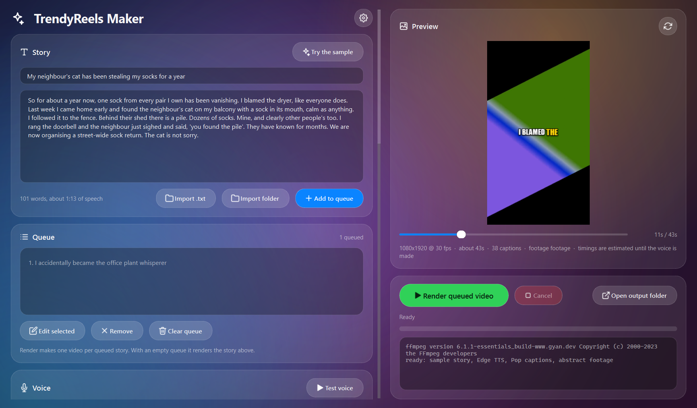
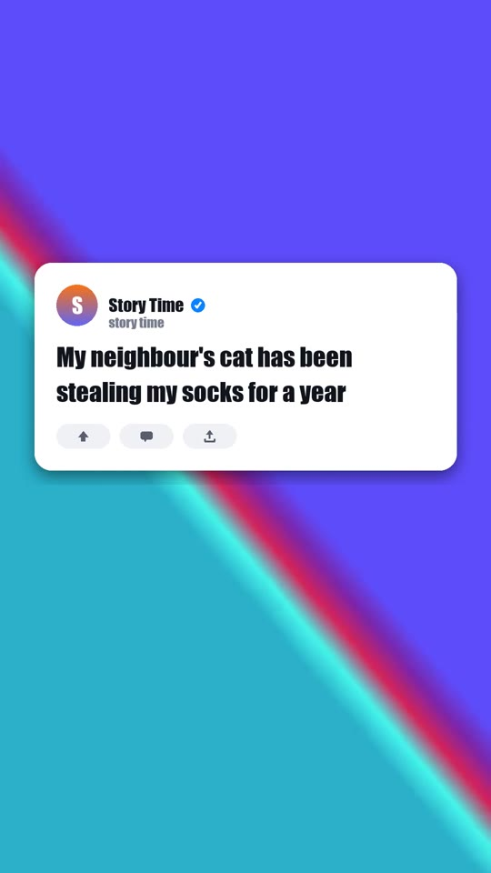
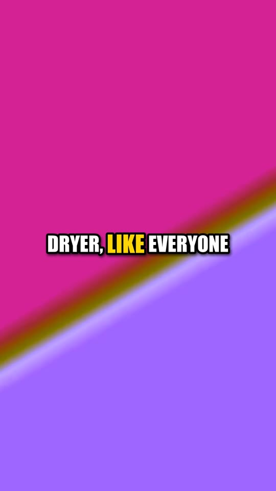

# TrendyReels Maker

**Free, open-source Reels / Shorts / TikTok video generator (Python, PySide6, FFmpeg): turn any story text into a vertical video with AI text-to-speech narration (Edge TTS, free), word-synced animated captions, a title card and your own background footage. A faceless-video maker that runs on your PC, no subscription.**

Paste a story, pick a voice, a caption look and some background footage, press **Render**: out comes a vertical short with an AI narration, word-synced pop captions and a title card, ready for Reels, Shorts and TikTok. One story at a time, or a whole queue from a text file.



<p align="center"> &nbsp; </p>

## Features

- **Story in, video out.** Type or paste a title and story. Shorthand like *AITA* or *TL;DR* is read out in full. Paragraphs become pauses.
- **Voices**: free **Edge TTS** neural voices (26 English voices built in, 300+ with one click) with exact word timings; **ElevenLabs** with your own key; **your own recording**; or no voice at all.
- **Captions that pop**: 1-8 words at a time, the spoken word highlighted and scaled, any font on your PC or a `.ttf` you downloaded, outline, shadow, backing box, colours, position. Four one-click looks: Pop, Clean, Boxed, Neon.
- **Word timings** come from the voice engine, so captions land exactly on the words. For your own recordings, install `faster-whisper` and the app listens to the audio; otherwise timings are estimated from the text.
- **Title card** shown while the title is read: channel name, avatar, no image assets needed.
- **Background footage**: a clip or a folder of clips (random or in order, random start point), fitted to the canvas by cropping or blur-fill, looped when short, with optional footage sound and background music.
- **Any canvas**: 9:16, 1:1, 16:9, 4:5 or a custom size, any fps, three quality levels.
- **Live preview**: scrub through the video before rendering a single frame.
- **Queue**: import a `.txt` (first line = title) or a folder of them, or the classic `Title -- Story` batch format; one video per story, already-rendered stories skipped so an interrupted batch can simply be run again.
- **Command line** for scripting, same engine and settings: `trendyreels --cli`.
- Drag-and-drop stories, footage, music and fonts onto the window. Settings are remembered.

## Install

**Windows exe**: download `TrendyReelsMaker.exe` from the [latest release](https://github.com/PhantomAnas/TrendyReels-Maker/releases/latest). You also need **FFmpeg** on your PATH: `winget install Gyan.FFmpeg`, or a build from [ffmpeg.org](https://ffmpeg.org/download.html), then restart the app. FFmpeg is not bundled.

**From source** (Windows, macOS, Linux, Python 3.10+):

```
git clone https://github.com/PhantomAnas/TrendyReels-Maker
cd TrendyReels-Maker
python -m venv .venv && .venv\Scripts\activate      # or: source .venv/bin/activate
pip install -e .
trendyreels
```

Or skip the install and run `python launcher.py` from the checkout (the dependencies still need to be installed: `pip install -r requirements.txt`).

Optional: `pip install faster-whisper` for word-accurate captions on your own recordings (the model downloads on first use).

## Use

1. **Story**: type a title and paste the story, or press *Try the sample*.
2. **Voice**: Edge TTS is free and needs no account; pick a voice, press *Test voice* to hear it. Speed and "read the title aloud" are here too.
3. **Captions**: choose a look, then tweak the font, size, words per caption and colours. The preview updates as you go.
4. **Background footage**: point at a video or a folder of videos (your own gameplay, satisfying clips, b-roll). Add music if you like.
5. **Render video**. Videos land in `~/Videos/TrendyReels Maker` (or the folder you choose).

For a batch, press *Add to queue* after each story, or import a text file:

```
My first title -- The whole story on one line...
Another title -- Another story...
```

or a file with the title on the first line and the story below (several stories separated by a `---` line), or a folder of such files.

### ElevenLabs

Paste your API key in the Voice card (tick *Remember on this PC* to keep it in the settings file) or set the `ELEVENLABS_API_KEY` environment variable. Press the refresh button to load your account's voices.

### Command line

```
trendyreels --cli --stories stories.txt --background ./footage --out ./shorts
trendyreels --cli --title "My title" --text story.txt --voice en-GB-RyanNeural --speed 1.1 --words 2
trendyreels --cli --provider file --narration my_recording.mp3 --text story.txt --background clip.mp4
trendyreels --cli --list-voices
trendyreels --cli --check                # is FFmpeg found?
```

With no other flags the CLI reuses the settings saved by the window; `--no-saved-settings` starts from defaults.

## How it works

The title and story are synthesized separately (so the title card ends exactly when the title does). Edge TTS and ElevenLabs report when each word is spoken; those timings are mapped back onto the script's own words, grouped into captions, and every frame is composed in Python (NumPy + Pillow) over footage decoded by FFmpeg, then streamed to FFmpeg for H.264 + AAC encoding together with the voice, footage sound and music. Preview and output are the same code path. Expect roughly a minute of rendering per minute of 1080x1920 video on a laptop CPU.

## Development

```
pip install -e ".[dev]"
pytest                               # text, timings, captions, footage, TTS plumbing and real FFmpeg renders
TRENDYREELS_NETWORK_TESTS=1 pytest   # also calls Edge TTS once
pyinstaller trendyreels.spec         # builds dist/TrendyReelsMaker.exe
python scripts/make_samples.py       # generated demo footage + stories (nothing copyrighted ships here)
python scripts/screenshot.py
```

Layout: `src/trendyreels/` has the engine (`text.py`, `tts.py`, `timing.py`, `captions.py`, `titlecard.py`, `background.py`, `render.py`, `batch.py`), `settings.py`, `cli.py`, and the PySide6 front end under `app/` (`main_window.py`, `widgets.py`, `theme.py`, `icons.py`, `worker.py`).

## Notes

- FFmpeg: found on PATH, next to the exe, or via the `TRENDYREELS_FFMPEG` environment variable. Without `ffprobe` the app still works.
- Edge TTS is an unofficial use of Microsoft's online voices through the `edge-tts` package; it needs an internet connection while rendering and may change without notice.
- Only use footage, music and stories you have the rights to. The old Reddit-scraping workflow this app grew out of is gone on purpose.
- Settings live in `%LOCALAPPDATA%\TrendyReelsMaker\settings.json` on Windows (platformdirs elsewhere).

## License

MIT. PySide6 is used under the LGPL; FFmpeg is called as an external program.
